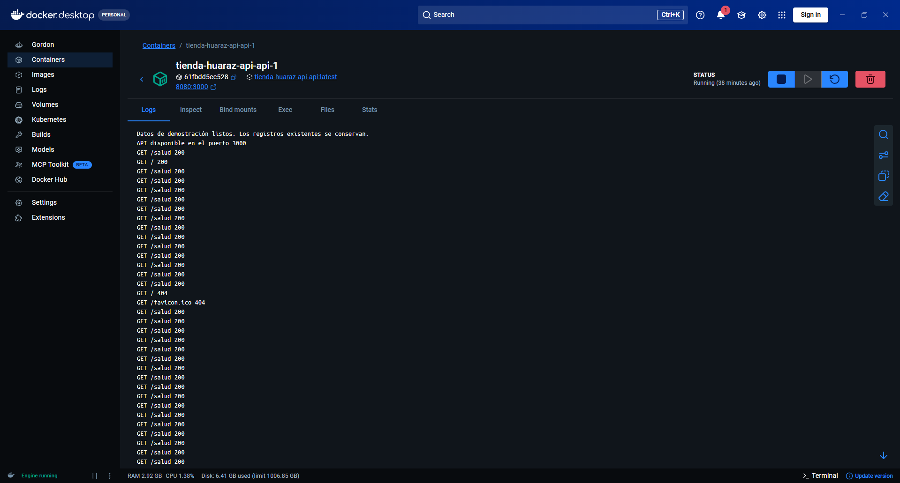
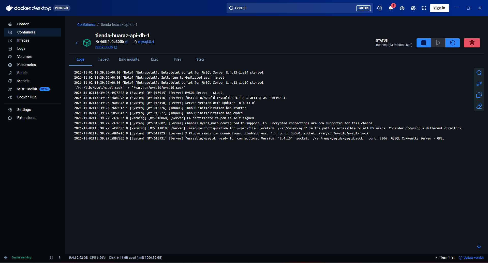
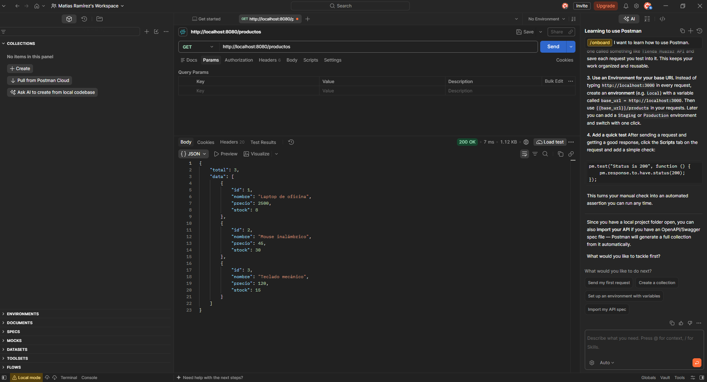
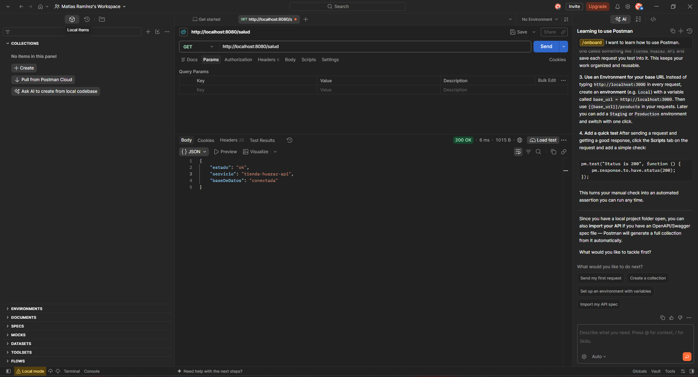

# Evidencias de Pruebas de Aceptación - API REST Tienda Huaraz

**SENATI CFP Huaraz**  
**Carrera:** Ingeniería de Software con IA - V Semestre  
**Curso:** Fullstack Developer Software - Semana 12  
**Estudiante:** Matías Ramírez  
**Instructor:** Ing. Carlos Alberto Durán Cueva  

Este documento resume las **15 pruebas mínimas de aceptación** ejecutadas sobre la API REST desplegada en Docker y consumida desde Postman Desktop y Newman CLI.

---

## Tabla Resumen de Pruebas Mínimas de Aceptación

| # | Prueba de Aceptación | Método y Ruta | Parámetros / Body | Código Esperado | Código Obtenido | Resultado |
|---|----------------------|---------------|-------------------|-----------------|-----------------|:---------:|
| 1 | **Salud de la API** | `GET /salud` | Ninguno | `200 OK` | `200 OK` | **Aprobado** |
| 2 | **Listado de productos** | `GET /productos` | Ninguno | `200 OK` | `200 OK` | **Aprobado** |
| 3 | **Login correcto** | `POST /auth/login` | `{ "email": "admin@tienda.local", "password": "***" }` | `200 OK` | `200 OK` | **Aprobado** |
| 4 | **Creación válida** | `POST /productos` | `{ "nombre": "Monitor de práctica", "precio": 850.5, "stock": 5 }` | `201 Created` | `201 Created` | **Aprobado** |
| 5 | **Consulta nuevo recurso** | `GET /productos/:id` | `id` generado por MySQL | `200 OK` | `200 OK` | **Aprobado** |
| 6 | **PATCH de stock** | `PATCH /productos/:id`| `{ "stock": 8 }` | `200 OK` | `200 OK` | **Aprobado** |
| 7 | **PUT completo** | `PUT /productos/:id` | `{ "nombre": "Monitor LED", "precio": 899.9, "stock": 8 }` | `200 OK` | `200 OK` | **Aprobado** |
| 8 | **Datos inválidos** | `POST /productos` | `{ "nombre": "X", "precio": -10, "stock": 2.5 }` | `400 Bad Request`| `400 Bad Request`| **Aprobado** |
| 9 | **Escritura sin token** | `POST /productos` | Sin cabecera `Authorization` | `401 Unauthorized`| `401 Unauthorized`| **Aprobado** |
| 10| **Escritura rol consulta** | `PATCH /productos/:id`| Bearer Token de rol `consulta` | `403 Forbidden` | `403 Forbidden` | **Aprobado** |
| 11| **Recurso inexistente**| `GET /productos/2147483647` | ID fuera de base de datos | `404 Not Found` | `404 Not Found` | **Aprobado** |
| 12| **Búsqueda por nombre** | `GET /productos/buscar?nombre=teclado` | Query param `nombre=teclado` | `200 OK` | `200 OK` | **Aprobado** |
| 13| **Eliminación y comprobación**| `DELETE /productos/:id` luego `GET` | Bearer Token `admin` | `204` y luego `404`| `204` y `404` | **Aprobado** |
| 14| **Ejecución con Docker** | `GET http://localhost:8080/salud` | Petición al puerto publicado `8080` | `200 OK` | `200 OK` | **Aprobado** |
| 15| **Persistencia con Docker**| `GET http://localhost:8080/productos` | Tras `docker compose down` y `up -d` | `200 OK` | `200 OK` | **Aprobado** |

---

## Capturas de Pantalla de Evidencias

### 1. Docker Desktop: Contenedor Base de Datos (`tienda-huaraz-api-db-1`)


### 2. Docker Desktop: Contenedor API (`tienda-huaraz-api-api-1`)


### 3. Postman Desktop: `GET /salud` (Puerto 8080)


### 4. Postman Desktop: `GET /productos` (Puerto 8080)


---

## Evidencias Destacadas en Postman y Docker

### Evidencia 1: Salud de la API (`GET /salud` en Docker puerto 8080)
- **URL:** `http://localhost:8080/salud`
- **Estado HTTP:** `200 OK` (Tiempo: 6 ms, Tamaño: 1015 B)
- **Cuerpo JSON:**
```json
{
  "estado": "ok",
  "servicio": "tienda-huaraz-api",
  "baseDeDatos": "conectada"
}
```

### Evidencia 2: Listado y Persistencia en MySQL (`GET /productos` en puerto 8080)
- **URL:** `http://localhost:8080/productos`
- **Estado HTTP:** `200 OK` (Tiempo: 7 ms, Tamaño: 1.12 KB)
- **Cuerpo JSON:**
```json
{
  "total": 3,
  "data": [
    { "id": 1, "nombre": "Laptop de oficina", "precio": 2500, "stock": 8 },
    { "id": 2, "nombre": "Mouse inalámbrico", "precio": 45, "stock": 30 },
    { "id": 3, "nombre": "Teclado mecánico", "precio": 120, "stock": 15 }
  ]
}
```

### Evidencia 3: Logs de Contenedores en Docker Desktop
- **`tienda-huaraz-api-db-1`:** Motor `MySQL 8.4.13` escuchando en el puerto interno `3306` (publicado en `127.0.0.1:3307`).
- **`tienda-huaraz-api-api-1`:** Servidor Express escuchando en el puerto interno `3000` (publicado en `127.0.0.1:8080`), superando los chequeos periódicos de salud (`GET /salud 200`).

### Evidencia 4: Automatización de Pruebas
- **Unitarias (`node --test`):** 19 de 19 pruebas aprobadas en 952 ms.
- **Script E2E (`scripts/verificar.js`):** 21 comprobaciones HTTP completadas con éxito.
- **Colección Postman vía Newman CLI:** 16 solicitudes ejecutadas, 16 aserciones exitosas, 0 fallos.

---

## 4. PREGUNTAS PARA COMPROBAR LA COMPRENSIÓN

A continuación respondo las 8 preguntas pedagógicas de la guía:

1. **Un POST recibe 201. ¿Qué evidencia demuestra además que el producto quedó almacenado?**
   * **Respuesta:** Consulto su `id` mediante `GET /productos/:id` para comprobar que me devuelve 200 OK con los datos, y luego compruebo la persistencia directa en MySQL ejecutando `SELECT id, nombre, precio, stock FROM productos WHERE id = ?;`.

2. **Un usuario inició sesión, pero recibe 403 al modificar stock. ¿Qué control lo rechazó?**
   * **Respuesta:** Lo rechazó la autorización por rol (`soloAdmin`). Aunque inicié sesión válidamente y tengo un token JWT, mi usuario tiene rol `consulta` y las rutas de modificación exigen estrictamente el rol `admin`.

3. **¿Por qué un precio enviado como `"85"` se rechaza?**
   * **Respuesta:** Porque el contrato exige un valor numérico, no texto. Mi middleware de validación comprueba que el campo sea de tipo `number` y rechaza strings con un código 400 Bad Request.

4. **¿Qué diferencia hay entre el JSON recibido y el objeto que utiliza el controlador?**
   * **Respuesta:** El JSON es texto plano serializado que recibo en la petición HTTP; `express.json()` interpreta ese texto recibido y lo convierte en un objeto con valores de JavaScript que puedo manipular en mi controlador.

5. **¿Por qué la API en Docker se conecta a `db` y no a `localhost`?**
   * **Respuesta:** Porque MySQL se ejecuta en otro servicio de la red interna de Compose. Si usara `localhost` dentro del contenedor de la API apuntaría a sí misma; por eso uso el nombre de servicio `db` que resuelve la red de Docker.

6. **¿Qué representa el mapeo `8080:3000`?**
   * **Respuesta:** El primer puerto (`8080`) pertenece a mi equipo anfitrión (Windows) para acceder desde el navegador o Postman, y el segundo (`3000`) pertenece al servicio que escucha dentro del contenedor.

7. **¿Por qué deben persistir los productos aunque una API se describa como sin estado?**
   * **Respuesta:** Porque la restricción sin estado (stateless) se refiere a que no guardo sesiones ni contexto entre solicitudes en la memoria del servidor, mientras que los datos del negocio sí deben guardarse y persistir en MySQL.

8. **¿Qué respuesta corresponde a una búsqueda válida sin coincidencias?**
   * **Respuesta:** Corresponde 200 OK con una colección vacía (`{ "total": 0, "data": [] }`), porque la consulta se ejecutó bien y la ausencia de coincidencias no es un error 404.
